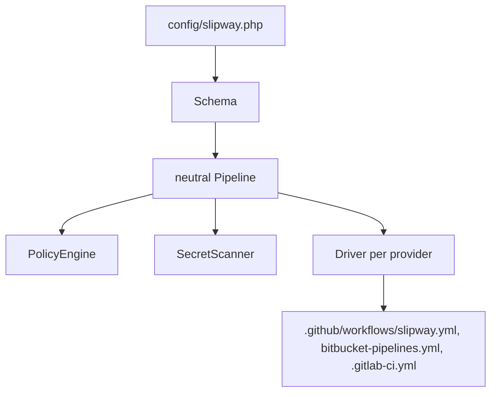

1. **Schema** validates everything and reports every error at once.
2. Stages become jobs and steps on a **neutral Pipeline**, with environments, artifact and secrets.
3. **PolicyEngine** checks rules such as `tests-before-deploy` and `approval-for-production`.
4. **SecretScanner** refuses credentials in the config or the generated output.
5. Each enabled **driver** (GitHub Actions, Bitbucket Pipelines, GitLab CI) writes YAML.

Output is deterministic: no timestamps, stable ordering, a short config hash in the header. That is what lets `slipway:check` detect drift with a byte comparison (line endings are ignored, so a Windows checkout with `core.autocrlf` is not reported as drift). Neither the header nor the hash contains the Slipway version, so upgrading Slipway never makes your committed pipeline files stale; only a change to the output itself does.
